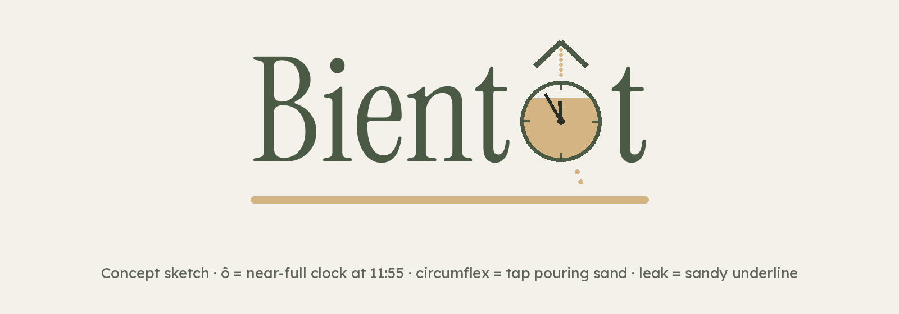
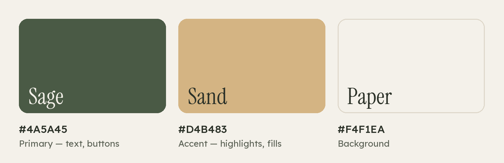
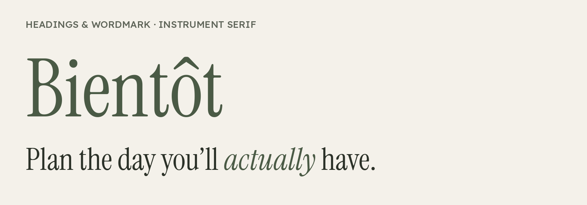
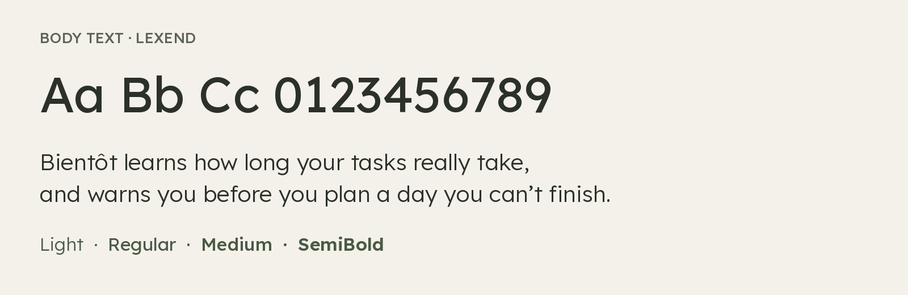

# Brand Decisions

Every brand choice, why it was made, and what was turned down.

## Name: Bientôt

French for _soon_, because "soon" is never soon, and the app corrects that.

- **Shortlist:** Actually, Sablier, Bientôt, Presque, Fallacy
- **Why Bientôt:** it has personality and a built-in story
- **Rejected:**
  - _Presque:_ hard to say, and the same joke is weaker
  - _Actually:_ clear but generic
  - _Sablier:_ doesn't say what the app does
  - _Fallacy:_ sounds negative
  - Earlier batches: desi (IST, Bas 5 Minute, Ho Jayega), nerdy (Hofstadter, Ninety-Ninety, Bayes), other French (En Vrai, Réel, Juste Cinq Minutes)

## Logo

Three ideas in one mark:

- The **ô** is a near-full clock
- The **circumflex** is a tap pouring sand into it
- A **leak** forms a sandy underline

A near-full clock means almost out of time.

**Rejected as standalone ideas:** tilted hourglass, circumflex as a clock hand, overflowing hourglass, stuck progress bar

_The image above is a concept sketch, not the final logo._

## Clock time: 11:55

"Almost time" is _bientôt_. It matches the near-full sand, and the hands point up toward the tap.

**Rejected:** 11:59 (last-minute), 10:10 (watch-ad smile), 12:00 (hands together), 4:04 (a joke), a four-hand planned-vs-actual clock (meaningful but cluttered at small sizes)

## Aesthetic

Calm and minimal, leaning toward journaling and habit tracking, with thin lines.

**No blue at all**, to stay clearly separate from RooMate.

**Rejected:** navy + amber, warm brown-charcoal

## Colours: Sage & Sand

| Role       | Colour | Hex       |
| ---------- | ------ | --------- |
| Primary    | Sage   | `#4A5A45` |
| Accent     | Sand   | `#D4B483` |
| Background | Paper  | `#F4F1EA` |

The calmest option: sand reads as real sand, and it's far from RooMate blue.

**Usage note:** sand is used for fills and highlights, never for text on paper, because the contrast is too low to read.

**Rejected:** Terracotta & cream (runner-up, more distinctive), Plum & blush (too beauty-brand), Olive & mustard (mustard too loud)

## Fonts

### Headings and wordmark: Instrument Serif

Narrow letters say "plan tight".

**Rejected:** Fraunces (good fit but very common), Young Serif, Newsreader, Gloock

### Body: Lexend

The calmest and most readable option; its wide, soft shapes match the brand.

**Rejected:** Karla (characterful but busier), Manrope (crisp but more "tech app"), Inter, DM Sans, Outfit, Plus Jakarta Sans, Nunito Sans, Figtree, Work Sans, Rubik

## Tagline

**"Plan the day you'll actually have."** It's calm and says what the app does.

README one-liner: _"Because 'soon' is never soon."_

**Rejected:** Define "soon.", Your "5 minutes," corrected., Know your time., Bientôt, vraiment.

## Tools used

| What                     | Tool                                                                       |
| ------------------------ | -------------------------------------------------------------------------- |
| Brainstorming and naming | Claude (discussing options, reasons and rejections)                        |
| Fonts                    | Google Fonts: Instrument Serif and Lexend (open source, OFL licence)       |
| Colour palette           | Hex codes chosen and checked for readable contrast                         |
| Brand images             | Python with Pillow, rendered with the real brand fonts                     |
| Logo concept             | Python with Pillow (a concept sketch; the final logo is still to be drawn) |
| App screen mockups       | Claude Design canvas                                                       |
